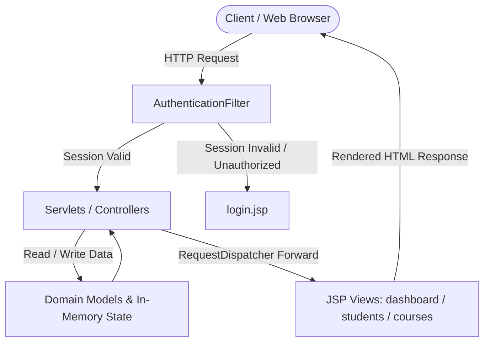

# 🎓 SkillHub Training Academy Portal

[](https://www.oracle.com/java/)
[](https://www.oracle.com/java/technologies/java-ee-glance.html)
[](https://developer.mozilla.org/en-US/docs/Web/HTML)
[](#-architecture--design-pattern)
[](https://javaee.github.io/glassfish/)

A clean, modular **Java EE Web Application** designed for training institutes and academies to manage students, trainers, courses, and administrative operations. Built following the **Model-View-Controller (MVC)** architectural pattern with core Java Servlets and JSP.

---

## 📑 Table of Contents
- [About The Project](#-about-the-project)
- [Key Features](#-key-features)
- [Architecture & Design Pattern](#-architecture--design-pattern)
- [Tech Stack](#-tech-stack)
- [Project Structure](#-project-structure)
- [Getting Started](#-getting-started)
- [Demo Credentials](#-demo-credentials)
- [Key Learnings & Takeaways](#-key-learnings--takeaways)
- [Future Enhancements](#-future-enhancements)

---

## 📖 About The Project

The **SkillHub Portal** is a web-based management system created to streamline administrative workflows for training centers. It provides an intuitive interface for staff to track course allocations, register and update student profiles, maintain trainer records, and monitor overall enrollment metrics in real time.

This project was built to master the fundamental concepts of web development in Java, focusing on **HTTP lifecycle**, **session management**, **route filtering**, and **clean separation of concerns** without relying on heavy third-party frameworks.

---

## ✨ Key Features

* 🔐 **Authentication & Route Protection:**
  * Secure administrator login with credential validation.
  * Dedicated `AuthenticationFilter` acting as a gatekeeper to prevent unauthorized access to internal pages.
  * Session-based user tracking and safe logout.

* 📊 **Interactive Dashboard:**
  * Quick-view metrics displaying real-time counts of enrolled students, available courses, and active instructors.

* 👨‍🎓 **Student Management:**
  * Register new students with contact details and course allocations.
  * Update existing student records.
  * Real-time tabular view of all registered students.

* 👨‍🏫 **Trainer Directory:**
  * Maintain instructor profiles alongside their specialized training domains.

* 📚 **Course Catalog:**
  * Manage academic courses, curriculum topics, and duration details.

* 👤 **Admin Profile Management:**
  * View current logged-in administrator profile details (Name, NIC, Contact, Address).

---

## 🏗️ Architecture & Design Pattern

The application is structured using the standard **Model-View-Controller (MVC)** architectural pattern to ensure clean decoupling between business logic, presentation, and data models:



* **Model (`model/`):** Plain Old Java Objects (POJOs) representing domain entities (`Student`, `Course`, `Trainer`).
* **View (`web/*.jsp`):** Server-side rendered JSP files presenting dynamic data using Expression Language (EL).
* **Controller (`controller/`):** Java Servlets handling incoming HTTP requests (GET/POST), processing data, and forwarding to corresponding views.
* **Filter (`controller/AuthenticationFilter`):** Centralized intercepting filter ensuring route protection across all secure pages.
* **Listener (`listener/AppContextListener`):** Initializes application-scoped bootstrap data when the web context starts up.

---

## 🛠️ Tech Stack

| Layer | Technology | Purpose |
|---|---|---|
| **Language** | Java (JDK 8+) | Core application logic |
| **Backend Framework** | Java EE / Servlet 3.1 | HTTP request handling, session control, filters |
| **Frontend** | JSP, HTML5, CSS3 | Dynamic server-side rendering and styling |
| **Architecture** | MVC Pattern | Modular design and separation of concerns |
| **Application Server** | GlassFish Server / Apache Tomcat | Servlet container |
| **Build Tool / IDE** | Apache Ant, NetBeans IDE | Compilation and deployment |

---

## 📂 Project Structure

```text
SkillHubPortal/
├── src/
│   ├── conf/
│   │   └── MANIFEST.MF
│   └── java/
│       ├── controller/
│       │   ├── AuthenticationFilter.java   # Centralized session route guard
│       │   ├── CourseController.java       # Handles course CRUD requests
│       │   ├── LoginServlet.java           # Authentication & session creation
│       │   ├── LogoutServlet.java          # Session invalidation & logout
│       │   ├── StudentController.java      # Student registration & updates
│       │   └── TrainerController.java      # Trainer profile management
│       ├── listener/
│       │   └── AppContextListener.java     # Bootstrap sample data into context scope
│       └── model/
│           ├── Course.java                 # Course domain model
│           ├── Student.java                # Student domain model
│           └── Trainer.java                # Trainer domain model
├── web/
│   ├── WEB-INF/
│   │   ├── glassfish-web.xml               # GlassFish deployment descriptor
│   │   └── web.xml                         # Web application configuration & listener mapping
│   ├── courses.jsp                         # Course management interface
│   ├── dashboard.jsp                       # Administrator dashboard & metrics
│   ├── login.jsp                           # Administrator login page
│   ├── profile.jsp                         # Administrator profile view
│   ├── students.jsp                        # Student registration & directory table
│   └── trainers.jsp                        # Trainer directory & management
├── build.xml                               # Apache Ant build script
└── README.md                               # Project documentation
```

---

## 🚀 Getting Started

### Prerequisites
Make sure you have the following installed on your machine:
* **Java Development Kit (JDK):** Version 8 or higher
* **IDE:** [Apache NetBeans](https://netbeans.apache.org/) (recommended) or IntelliJ IDEA Ultimate / Eclipse
* **Server:** GlassFish Server (4.x / 5.x) or Apache Tomcat (8.x / 9.x)

### Running the Application (NetBeans)

1. **Clone the Repository:**
   ```bash
   git clone https://github.com/savindugeethma/SkillHub-Academy-Portal.git
   ```

2. **Open the Project in NetBeans:**
   * Open NetBeans IDE.
   * Go to `File` $\rightarrow$ `Open Project...`
   * Select `SkillHubPortal` and click **Open**.

3. **Resolve Server Configuration:**
   * Right-click on the project in NetBeans $\rightarrow$ **Properties**.
   * Under **Run**, ensure your **Server** is set to **GlassFish Server** (or Apache Tomcat) with Java EE version set to **Java EE 7 / 8 Web**.

4. **Build and Run:**
   * Right-click the project $\rightarrow$ **Clean and Build**.
   * Click the green **Run Project** button (or press `F6`).
   * The browser will launch automatically at:
     ```
     http://localhost:8080/SkillHubPortal/
     ```

---

## 🔑 Demo Credentials

You can log in to the portal using any of the following pre-configured administrative accounts:

| Username | Password | Role | Administrator Name |
|---|---|---|---|
| `admin` | `1234` | Head Admin | R. A. S. Geethma |
| `admin2` | `5678` | Staff Admin | S. B. Perera |

---

## 💡 Key Learnings & Takeaways

Working on this project provided hands-on experience with fundamental software engineering concepts:
* **Understanding Java Web Architecture:** Gained practical understanding of how web servers, servlet containers, and HTTP request-response cycles operate under the hood.
* **Separation of Concerns (MVC):** Kept business logic isolated inside controllers and models while keeping JSP views purely focused on rendering.
* **Security & Filters:** Implemented an intercepting `Filter` pattern to centralize route authentication, preventing unauthenticated users from bypassing login.
* **Scope Hierarchy:** Learned when and how to utilize `RequestScope`, `SessionScope`, and `ApplicationScope` (`ServletContext`) for state management.

---

## 🔮 Future Enhancements

Realistic roadmap for upcoming iterations:
- [ ] **Database Integration:** Connect a MySQL database using JDBC and DAO (Data Access Object) design pattern.
- [ ] **Form Validations:** Add both client-side (JavaScript) and server-side validation for phone numbers, emails, and student IDs.
- [ ] **UI Modernization:** Integrate Bootstrap 5 or Tailwind CSS for responsive mobile and desktop layouts.
- [ ] **Build Tool Migration:** Migrate from Apache Ant to Apache Maven for streamlined dependency management.

---

## 👨‍💻 Author
**Savindu Geethma**
* GitHub: [@savindugeethma](https://github.com/savindugeethma)

---

## 📄 License
This project is developed for educational and portfolio demonstration purposes.
